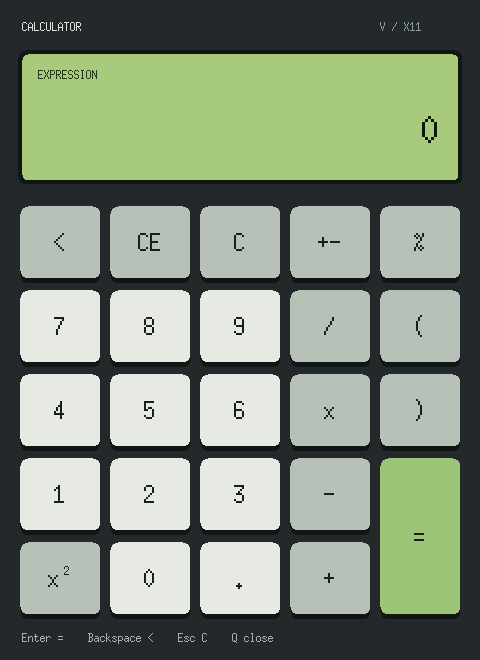
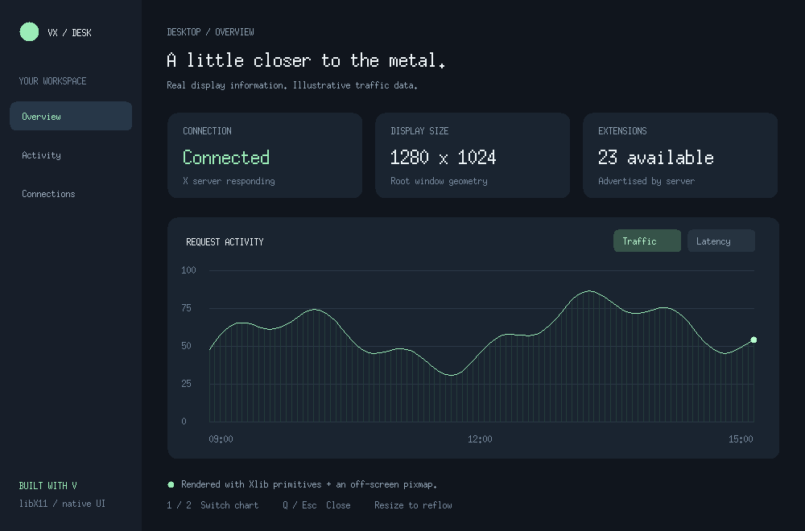
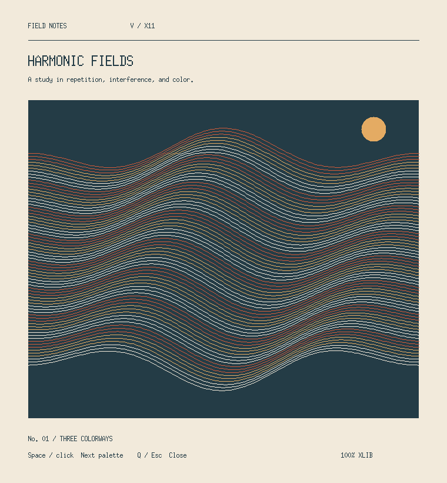
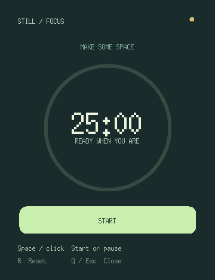
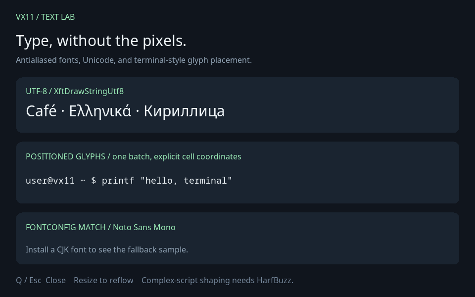

# Example gallery

Run these commands from the repository root. If V is not on your PATH, replace
`v` with `/home/diviocity/.local/bin/v`. An X11 display (including Xwayland) must
be available through `DISPLAY`.

## Calculator — green LCD and five-column keypad



```sh
v -path '..|@vlib|@vmodules' run examples/calculator.v
```

A working calculator with a green input/display, black lettering, and this keypad:

```text
 <   CE    C   +-   %
 7    8    9    /   (
 4    5    6    x   )
 1    2    3    -   =
 x²   0    .    +   =
```

The equals key is one button spanning the last two rows. Click the keys or type
an expression. **Enter / =** evaluates, **Backspace / Delete** deletes,
**Escape / C** clears everything, **E** clears the current entry, **N** changes
its sign, **S** squares it, and **Q** closes the window. Normal number, decimal,
operator, percent, and parenthesis keys work directly; use **\*** for multiply.

The evaluator applies multiplication/division before addition/subtraction and
supports nested parentheses and unary signs. Percent is a postfix divide by 100:
`200 * 10%` is `20`. Square applies to the current signed number or parenthesized
group. **CE** removes that last entry while preserving the preceding expression;
**C** clears it all. Invalid expressions and division by zero show a message in
the display so the expression can be corrected. Typing a number after a result
starts a new expression; typing an operator continues from the result.

The evaluator is isolated in [calc/model.v](calc/model.v), with arithmetic and
editing tests runnable with `v test examples/calc`. The GUI uses the shared
drawing helper and only needs libX11. It also supports `--smoke` and
`--screenshot PATH` as described below.

## VX Desk — desktop dashboard



```sh
v -path '..|@vlib|@vmodules' run examples/dashboard.v
```

A dark dashboard with a sidebar, status cards, and an interactive chart. Display
geometry and extension counts come from the connected server; the traffic and
latency curves are explicitly illustrative data. Press **1 / 2** or click the
chart tabs to switch views. **Q / Escape** closes the window. The sidebar is
visual framing; the chart tabs are interactive.

Demonstrates native connections and events, resizing, color allocation, fonts,
vector primitives, and an off-screen pixmap copied to the window on each redraw.
Requires only libX11 and its development headers.

## Harmonic Fields — generative poster



```sh
v -path '..|@vlib|@vmodules' run examples/poster.v
```

A resizable, deterministic line-art poster with three coordinated palettes.
Press **Space** or click anywhere to change the palette and wave phase.
**Q / Escape** closes it. The art is generated entirely from Xlib lines and
circles, with no image assets or graphics toolkit.

Demonstrates procedural drawing, palette changes, double buffering, and layout
that responds to window size. Requires only libX11 and its development headers.

## Still — shaped focus timer



```sh
v -path '..|@vlib|@vmodules' run examples/focus.v
```

A 25-minute focus timer in a window whose actual bounding region has rounded
corners. Press **Space** or click **Start / Pause** to toggle the timer, **R** to
reset, and **Q / Escape** to close. The timer starts paused. Resizing recomputes
the SHAPE region. Your window manager may still draw a rectangular title bar.

Demonstrates `vx11.shape`, checked extension binding, region construction, arc
progress, and a nonblocking event loop. Requires libXext and SHAPE support on the
server, in addition to libX11. The timer does not inhibit the screen saver.

## Smaller starting points

| File | Purpose | Extra extension libraries |
| --- | --- | --- |
| [hello.v](hello.v) | Small window, drawing, and WM close handling | None |
| [events.v](events.v) | A bound method passed to the native event loop | None |
| [extensions.v](extensions.v) | Monitor heads, idle time, and extension versions | libXinerama, libXext, libXss |

## Drawing helper and captures

The visual demos share [demo/canvas.v](demo/canvas.v), a small example-only
renderer. It owns a pixmap and GC, caches allocated colors, and disables graphics
exposure events on copies. Headings use cached runs from server-rendered bitmap
text, scaled with XFillRectangles; even a minimal X server with only `fixed` can
render them. This intentionally uses core bitmap fonts, so headings have a pixel
style rather than antialiased typography. All resources are released before the
window and display.

The helper is imported as `vx11.examples.demo`; it is not part of the supported
library API. These examples use ASCII text and do not demonstrate Unicode text
input, Xft, or font shaping.

Each visual demo supports two noninteractive modes:

```sh
v -path '..|@vlib|@vmodules' -o /tmp/vx11-dashboard examples/dashboard.v
xvfb-run -a /tmp/vx11-dashboard --smoke
xvfb-run -a /tmp/vx11-dashboard --screenshot /tmp/dashboard.ppm
magick /tmp/dashboard.ppm /tmp/dashboard.png
```

`--smoke` draws, synchronizes with the server, and exits. `--screenshot PATH`
captures the actual rendered pixmap as binary PPM, then exits. Captures require
a TrueColor visual. PPM captures show the complete content buffer, without
window-manager decorations or the SHAPE region's transparent corners. The PNG
previews above were rendered on Xvfb; no mockups or external art assets are used.
ImageMagick is optional and needed only for converting PPM captures to PNG.

## Text Lab — antialiased Xft fonts



```sh
v -path '..|@vlib|@vmodules' run examples/xft_text.v
```

Shows antialiased UTF-8 text, a batch of explicitly positioned monospace glyphs,
Fontconfig's actual selected family, and a CJK fallback sample when a suitable
font is installed. Q / Escape closes it. Resizing closes the Xft renderer before
replacing the backing pixmap and creates a renderer for the new drawable.
It supports the same `--smoke` and `--screenshot PATH` modes as the other demos.
Requires the Xft, Fontconfig, and FreeType development packages. The font samples
use installed fonts; complex-script shaping is outside this example's scope.
